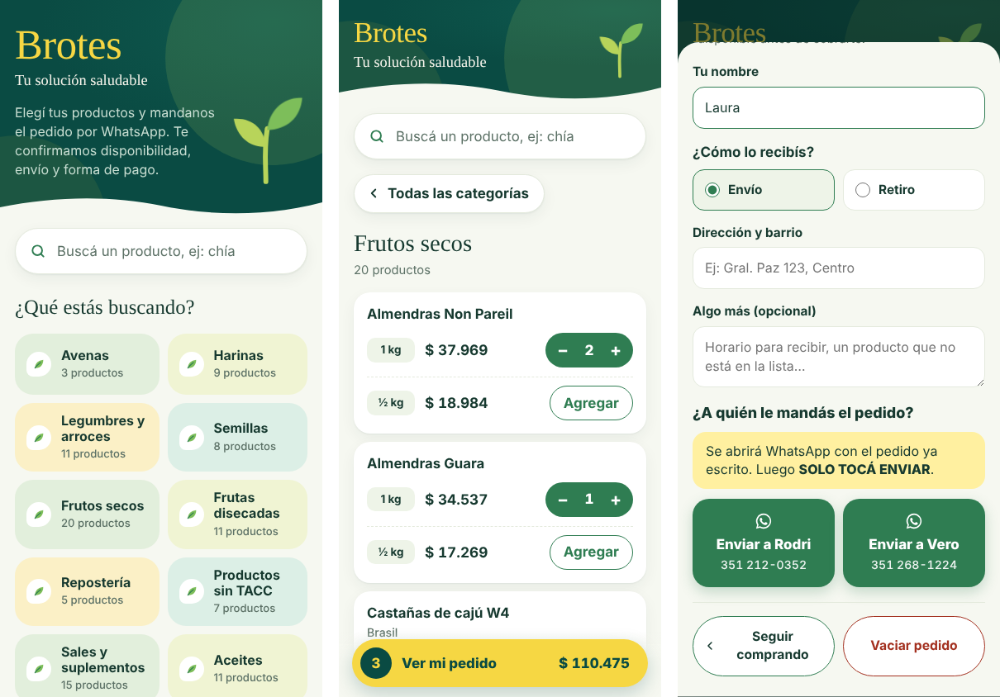

# Brotes · Tu solución saludable

Tienda online simple para **Brotes**, un emprendimiento de productos saludables de Córdoba (harinas, semillas, frutos secos, yerbas, condimentos y más).

El cliente elige sus productos desde el celular, completa su nombre y forma de entrega, y el pedido se abre en **WhatsApp ya escrito**, listo para enviar a Rodri o a Vero. No hace falta WhatsApp Business, ni base de datos, ni pagos online: el emprendimiento confirma disponibilidad y forma de pago por chat, como siempre.



## Qué hace

- Catálogo de 180 productos en 15 categorías, con buscador que ignora acentos.
- Pantalla de inicio limpia: buscador y categorías como pastillas; los productos aparecen al elegir una categoría.
- Pedido con cantidades, total estimado y datos de entrega (envío o retiro).
- Botón para enviar el pedido por WhatsApp a la persona que el cliente elija.
- Los precios se leen de una **planilla de Google Sheets** publicada como CSV: el emprendimiento actualiza precios y stock sin tocar código.
- Si la planilla no responde, la tienda usa una lista de precios de respaldo incluida en el archivo.
- El pedido en curso queda guardado en el navegador del cliente.
- Diseño pensado para celular y para personas de cualquier edad: botones grandes, textos claros, modo oscuro automático.

## Tecnología

Un solo archivo `index.html` con HTML, CSS y JavaScript sin frameworks ni dependencias. Se publica gratis en Netlify.

## Cómo configurarlo

Todo lo editable está al principio del `<script>` de `index.html`, en el objeto `CONFIG`:

```js
const CONFIG = {
  planilla: "",          // link CSV de la planilla publicada
  whatsapp: [ ... ],     // nombres y números (formato 549 + código de área + número)
  credito: { texto: "", link: "" }  // firma opcional al pie
};
```

### Planilla de precios

1. Subir `planilla/Brotes_Precios_Tienda.xlsx` a Google Drive y abrirla con Google Sheets.
2. Columnas: **Categoría · Producto · Presentación · Precio · Disponible** (`Sí` / `No`).
3. *Archivo → Compartir → Publicar en la web* → hoja "Precios" → formato **CSV**.
4. Pegar el link en `planilla` dentro de `CONFIG`.

### Publicar en Netlify

1. Crear cuenta en [netlify.com](https://www.netlify.com/).
2. *Add new site → Import an existing project → GitHub* y elegir este repositorio (cada cambio que se suba se publica solo), o *Deploy manually* arrastrando la carpeta.
3. Cambiar el nombre del sitio en *Site configuration* (por ejemplo `brotes-saludable.netlify.app`).
